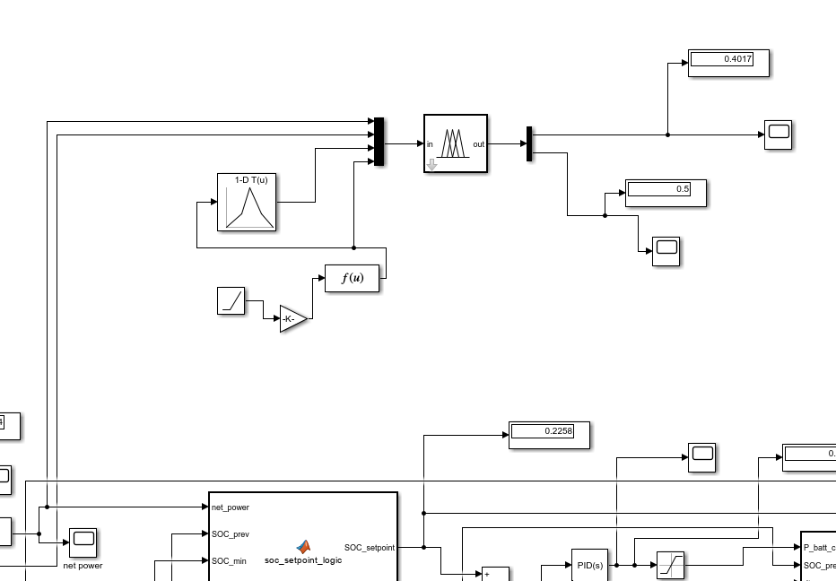
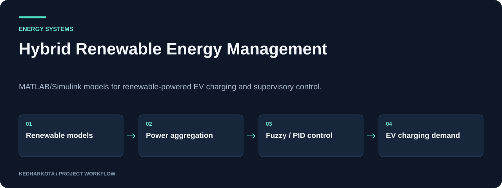

# Hybrid Renewable Energy Management

MATLAB/Simulink models for renewable-powered EV charging and supervisory control.

**MATLAB · Simulink · Fuzzy logic · PID control**

[Overview](#overview) · [Getting started](#getting-started) · [Repository guide](#repository-guide) · [Reproducibility](docs/REPRODUCIBILITY.md)



*Original fuzzy-controller model figure from the project presentation.*

## Overview

A control-systems project exploring how hybrid renewable generation can serve an EV charging station. The repository combines solar, wind, hydro, and biogas simulation files with an EV fuzzy-control model and a project presentation. The presentation discusses fuzzy logic and PID responses, renewable utilization, charging cost, and power balancing.

## What this project includes

- Separate Simulink models for solar, wind, hydro, and biogas generation.
- EV charging and fuzzy-control model alongside a base model.
- Presentation documenting objectives, control methodology, and simulation plots.
- Exploration of renewable supply, demand, tariff, and charging-period inputs.

## Workflow



*Explanatory diagram. Detailed implementation and availability notes follow below.*

## Getting started

Requires MATLAB and Simulink. The repository does not specify a MATLAB release or complete toolbox list. Check model dependencies in your installation before running.

From MATLAB, change to the repository directory and inspect the models:

```matlab
open_system('base.slx');
open_system('ev_fuzzy.slx');
```

Review initial conditions, source inputs, controller configuration, and simulation stop time before selecting **Run**.

### Required inputs and current constraints

Supply model-specific input signals and any external workspace variables requested by Simulink. Fuzzy Logic Toolbox may be required by fuzzy-controller blocks. MATLAB simulations were not executed during this documentation update.

## Repository guide

| File | Purpose |
| --- | --- |
| [base.slx](base.slx) | Base simulation model. |
| [ev_fuzzy.slx](ev_fuzzy.slx) | EV/fuzzy-control simulation. |
| [solar_final.slx](solar_final.slx) | Solar generation model. |
| [winddd.slx](winddd.slx) | Wind generation model. |
| [hydro.slx](hydro.slx) | Hydro generation model. |
| [biogass.slx](biogass.slx) | Biogas generation model. |
| [CS Final.pptx](CS%20Final.pptx) | Project review and original simulation figures. |

## Results and project status

The committed presentation includes simulation results and a literature review. Literature-review cost-reduction figures belong to cited studies and should not be presented as measured results from this repository. The preview above reproduces an original controller-model image from the presentation.

## Next steps

- Record the MATLAB release, required toolboxes, and model initialization steps.
- Export input scenarios and measured controller comparisons in a machine-readable format.

## Documentation maintenance

Local documentation links and image headers are checked on pull requests and relevant pushes by the [documentation workflow](.github/workflows/docs.yml). Run the same check locally:

```bash
python tools/check_docs.py
```

See the [reproducibility guide](docs/REPRODUCIBILITY.md) for evidence, missing artifacts, and visual-source notes. The check validates documentation files; it does not train models or certify application behavior.

---

[More projects by kedharkota](https://github.com/kedharkota?tab=repositories)
